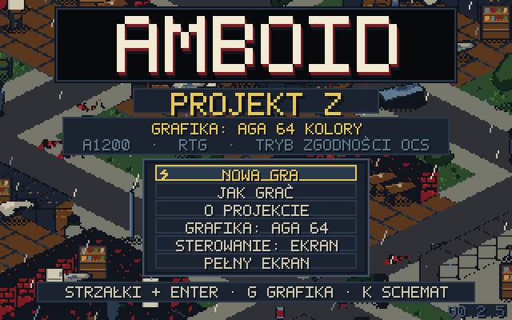
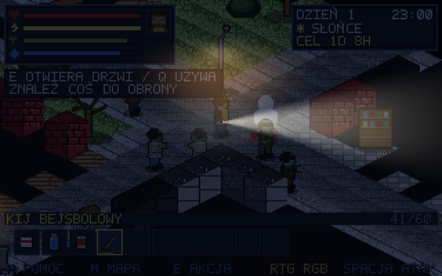
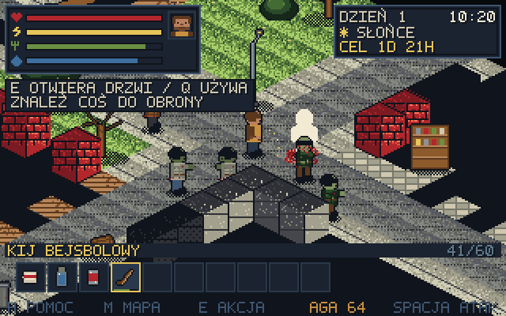
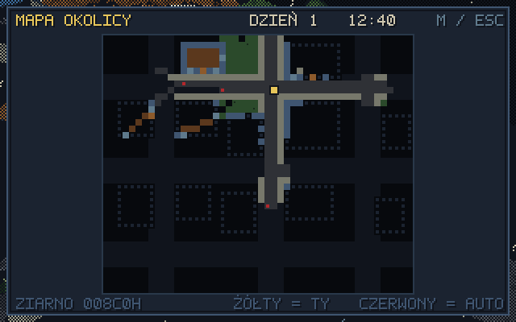
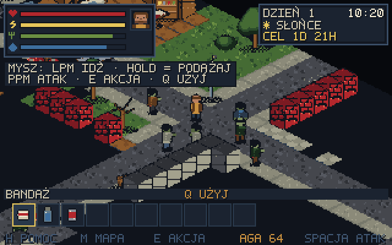
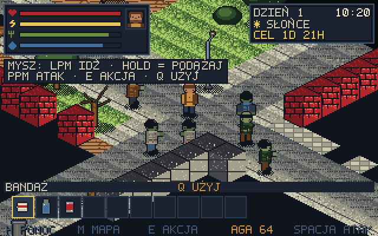
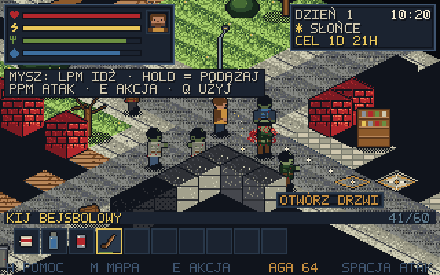
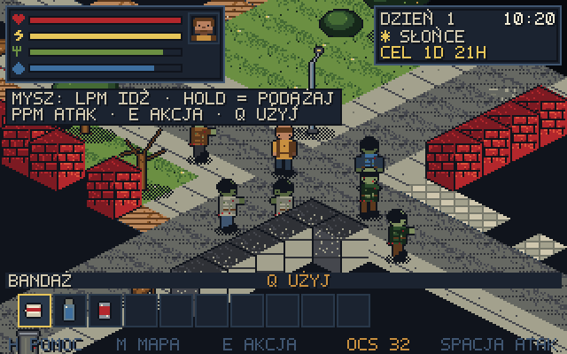

<p align="center">
  
</p>

<h1 align="center">AMBOID — PROJEKT Z</h1>

<p align="center">
  Izometryczny survival zombie inspirowany <b>Project Zomboid</b>,<br>
  zaprojektowany tak, jakby miał powstać na <b>rozbudowaną Amigę 1200 (AGA)</b><br>
  albo system z <b>kartą RTG</b>.<br>
  <b>64 kolory. Światło RGB. 320×200. 68030.</b>
</p>

<p align="center">
  <a href="#uruchomienie"><b>▶ Zagraj w przeglądarce</b></a> ·
  <a href="docs/AMIGA.md"><b>Dokumentacja techniczna</b></a> ·
  <a href="docs/GDD.md"><b>Projekt gry</b></a>
</p>

---

## O co chodzi

AMBOID to fanowski hołd dla Project Zomboid przeniesiony w realia Amigi. Nie jest to
port — to wariacja na temat: małe miasteczko widziane w izometrii, głód, pragnienie,
ciemność, zombie przyciągane hałasem i deski na oknach. Wszystko upakowane
w limitach Amigi — ale bez ascezy A500: 64 kolory AGA i prawdziwe światło RGB
na karcie RTG, z trybem zgodności OCS jako opcją.

Gra jest w pełni grywalna: eksplorujesz, przeszukujesz meble, walczysz, zabijasz okna
deskami, śpisz w łóżkach i próbujesz przetrwać **dwie doby**.

<p align="center">
  
  
</p>
<p align="center">
  
  
</p>

## Wersja v0.2.5 — grunt i podłogi od nowa

**Pobierz gotowy projekt (bez Gita):**
[**ZIP źródeł v0.2.5**](https://github.com/diWhizZ/AmBoid/archive/refs/tags/v0.2.5.zip) ·
[Release v0.2.5](https://github.com/diWhizZ/AmBoid/releases/tag/v0.2.5) ·
[ZIP gałęzi roboczej](https://github.com/diWhizZ/AmBoid/archive/refs/heads/arena/b923a220-amboid.zip) ·
[aktualny main.zip](https://github.com/diWhizZ/AmBoid/archive/refs/heads/main.zip).

**Status publikacji:** PR #4 (ta wersja) otwarty z gałęzi sesji; tag i Release
v0.2.5 tworzone z tego samego commitu co PR. Historyczny v0.2.4 pozostaje
nietknięty: [tag v0.2.4](https://github.com/diWhizZ/AmBoid/releases/tag/v0.2.4).
Ograniczenie wysyłki osobnego assetu `AmBoid-*.zip` na Release jest opisane
w [docs/PUBLIKACJA.md](docs/PUBLIKACJA.md) — ZIP tagu/gałęzi działa zawsze.

Changelog v0.2.5 (grafika terenu i podłóg, bez zmian geometrii i mechanik):
- **koniec pasmowania**: usunięty gradient „oświetlenia” pojedynczego rombu,
  który powielony na płaskiej powierzchni dawał ukośne pasy;
- **koniec powtarzalnych prążków**: asfalt nie ma dwóch ciemnych linii w każdym
  kaflu, beton poziomej szczeliny, drewno linii co 3 piksele;
- wzory strukturalne (fugi płyt chodnika, deski, siatka ceramiki, dylatacje
  betonu) liczone w **UV płaszczyzny podłogi** — są ciągłe między kaflami
  i leżą w osiach izometrii, nie ekranu;
- **dobór wariantów**: dokładna faza siatki strukturalnej + zestaw detalu
  z hasza(seed, x, y); deterministyczny, stabilny przy przesuwaniu kamery,
  bez `Math.random()` w klatce i bez zużywania RNG rozgrywki;
- **maska rombu 256 px** (test środka piksela): duża płaszczyzna składa się
  bez dziur i bez podwójnego pokrycia (było 272 px i ~6% nadpisań → szwy);
  globalny `PixelBuffer.fillPoly` pozostał nietknięty;
- **4–8 wariantów** na materiał o zbliżonej średniej jasności (koniec
  szachownicy z jaśniejszych/ciemniejszych rombów); szczegóły jako celowe
  skupiska pikseli, czytelne po pomniejszeniu 0,75×;
- materiały wg briefu: asfalt = ciemna spokojna masa z pęknięciami i łatkami,
  trawa = stonowana zieleń z kępami darni i przerzedzeniami (bez kwiatka
  co kilka kafli), chodnik = czytelne płyty 2×2 z delikatnymi fugami,
  **krawężnik tylko na prawdziwej granicy z jezdnią**, ziemia = płaty
  i pojedyncze kamienie, beton = spokojne pola, deski = przesunięte łączenia,
  ceramika = siatka w perspektywie podłogi, wykładzina = matowa z przetarciem,
  żwir = skupiska kamieni, woda = ograniczone refleksy;
- narzędzia developerskie: `npm run texshots` (powtarzalne kadry porównawcze
  w ignorowanym `shots/`) i `node tools/texbench.mjs` (koszt atlasu i czasu
  renderu tego samego kadru).

Koszt (pomiar `tools/texbench.mjs`, ten sam kadr):
| | v0.2.4 | v0.2.5 |
| --- | --- | --- |
| kafle terenu | 30 | 54 |
| chunky 8 bit | 15 360 B | 27 648 B |
| 6 bitplanów AGA | 11 520 B | 20 736 B |
| maska rombu | 30 × 64 B | 1 × 64 B (wspólna) |
| render kadru far 0,75× | 2,208 ms | 1,941 ms |
| `buildArt()` | 41,1 ms | 31,6 ms |

Zmiany z v0.2.4 (widok daleki) pozostają w mocy:
- domyślny **widok daleki 0,75×**: świat 427×267, ekran nadal **320×200**;
- **V** przełącza daleki / bliski; `?view=far|close` i zapis `amboid.view`;
- skalowanie **indeksów palety, MAJORITY 2×2** — bez uśredniania RGB;
- HUD, kursor i ostre kropki trasy nie są pomniejszane;
- współrzędne myszy, FOV, światła RTG i wyprzedzenie kamery uwzględniają zoom;
- pełne światło dnia także na zapamiętanych kaflach; całopikselowa kamera.

<p align="center">
  
  
</p>

## Uruchomienie

Potrzebujesz tylko Node.js (bez żadnych zależności produkcyjnych):

Windows / PowerShell (również przy zablokowanym `npm.ps1`):

```powershell
cd D:\pobrane\zomboid\AmBoid-0.2.5
node tools/serve.mjs
# otwórz http://localhost:8080
```

Możesz też otworzyć `index.html` przez dowolny serwer statyczny. Gra nie wymaga
budowania ani instalacji pakietów — to czysty HTML5 + ES modules.

Opcjonalnie własne miasteczko i tryb grafiki:
`http://localhost:8080/?seed=ABC123&gfx=rtg&view=far` (`ocs`, `aga` lub `rtg`; `far` lub `close`).

**Windows — pełna instrukcja krok po kroku:** [docs/WINDOWS.md](docs/WINDOWS.md)
(Node.js, PowerShell, porty, testy, typowe problemy).

### Sterowanie

| Klawisz | Akcja |
| --- | --- |
| `W A S D` / strzałki | ruch (schemat EKRAN lub IZO — patrz niżej) |
| `Shift` / `Ctrl` | bieg / skradanie |
| `Spacja` / **PPM** | atak (PPM — w stronę kursora) |
| `E` | drzwi, przeszukanie, podniesienie łupu, zabicie okna |
| `Q` | użyj wybranego przedmiotu |
| `1`–`0` | wybór slotu |
| `F` / `M` / `H` | latarka / mapa / pomoc |
| `V` | widok daleki **0,75×** ↔ bliski **1×** |
| `G` | przełącz tryb grafiki: OCS 32 → AGA 64 → RTG |
| `K` | przełącz schemat ruchu: **EKRAN** ↔ **IZO** |
| `Esc` | pauza |

**Mysz (0.2.3, etap 1).** Klikasz świat, a ocalały sam idzie wyznaczoną trasą:

| Mysz | Akcja |
| --- | --- |
| **LPM** na ziemi | idź do kursora; trzymanie LPM = podążanie za kursorem |
| **LPM** na drzwiach / pojemniku / łóżku / łupie | podejdź i wykonaj tę jedną akcję |
| **LPM** na zombie | podejdź i stań obok — **bez automatycznego ataku** |
| **PPM** | atak lub strzał w stronę kursora |
| kursor poza planszą, na HUD | rozkaz nie jest wydawany |

Trasa rysowana jest kropkami, kafel pod kursorem ma kolor zależny od akcji
(biały — idź, złoty — interakcja, żółty — zombie, czerwony — blokada,
szary — brak linii wzroku do zombie).
Nowe kliknięcie anuluje poprzedni rozkaz, a kamera przesuwa się za kursorem
(martwa strefa wokół środka ekranu). Klawiatura i pad działają bez zmian.

<p align="center">
  
</p>

**Dwa schematy ruchu.** Izometria 2:1 nie ma jednej „oczywistej” strzałki —
dlatego są dwa schematy, a wybór zapisuje się w przeglądarce:

| Schemat | Pojedynczy klawisz idzie… | Dla kogo |
| --- | --- | --- |
| **EKRAN** (domyślny) | W góra, S dół, A lewo, D prawo — dokładnie jak na ekranie | większość graczy |
| **IZO** | po skosie: W ↖, D ↗, S ↘, A ↙ jak w klasycznych grach izo | gdy wolisz „chodzić po krawędziach” kafli |

W obu schematach dwa sąsiednie klawisze dają ruch po osi ekranu (np. w IZO
`S`+`D` idzie w prawo, a `W`+`A` w lewo). Schemat zmienisz też w menu:
`STEROWANIE: EKRAN` / `STEROWANIE: IZO`.

**Pad (Gamepad API).** Podłączony pad działa od razu, bez konfiguracji
(Chrome, Edge, Firefox; tryb XInput). Gałka i D-pad zawsze poruszają **względem
ekranu** — niezależnie od tego, czy masz włączony schemat EKRAN, czy IZO:

| Pad | Akcja |
| --- | --- |
| lewa gałka / D-pad | ruch i nawigacja w menu |
| **A** / krzyżyk | atak, zatwierdzenie |
| **B** / kółko | interakcja (`E`) |
| **X** / kwadrat | użyj przedmiotu (`Q`) |
| **Y** / trójkąt | latarka (`F`) |
| **LB** / **RB** | poprzedni / następny slot |
| **LT** / **RT** | skradanie / bieg |
| **Back** | mapa |
| **Start** | pauza / powrót |

## Co jest w grze

- **Proceduralne miasteczko** — siatka ulic, 12 budynków z wnętrzami (dom, sklep,
  magazyn, przychodnia, stacja paliw), meble, samochody, płoty, trupy.
  To samo ziarno = to samo miasto.
- **Cykl dnia i nocy** — zmierzch, noc, latarnie uliczne, latarka, deszcz i chmury.
  W RTG światło liczone jest naprawdę: stożek latarki, ciepłe halo latarni i
  niebieska noc. Zasięg widzenia zależy od pory dnia i pogody (FOV po kaflach).
- **Zombie** — 40+ na start, horda co noc o 21:00. Reagują na hałas, gonią po
  linii wzroku, wyłamują drzwi i rwą deski z okien.
- **Survival** — HP, energia, głód, pragnienie, krwawienie, zakażenie od ugryzień.
  Sen, jedzenie, picie, bandaże, tabletki.
- **Walka i łupy** — pięści, kij, siekiera, nóż, młotek, pistolet (głośny!),
  21 typów przedmiotów, przeszukiwanie pojemników, trwałość broni.
- **Zabijanie okien** — młotek + deski + gwoździe, do 3 warstw na okno.
- **Cel** — przetrwać do początku trzeciego dnia (licznik w HUD), a potem graj dalej.

Cała grafika i dźwięk powstają **proceduralnie** — w repozytorium nie ma ani jednego
pliku PNG używanego przez grę ani pliku audio. Paleta bazowa ma 32 kolory, a AGA
dokłada 32 półtony; OCS mapuje je z powrotem na bazę. HUD ma portret ocalałego,
który zmienia się wraz z ranami i zakażeniem, a nocne niebo przechodzi w granat.

Co dalej z grafiką — konkretny, wyceniony plan: **[docs/GRAFIKA.md](docs/GRAFIKA.md)**.

## Trzy tryby grafiki

Ten sam tileset i ta sama logika działają w trzech profilach. Przełączasz je
klawiszem **G** (albo w menu: `GRAFIKA`) — wybór zapisuje się w przeglądarce.

| Profil | Kolory | Bitplany | Światło | Zastosowanie |
| --- | --- | --- | --- | --- |
| **OCS 32** | 32 | 5 | tablice przygaszenia | A500, CD32, tryb zgodności |
| **AGA 64** | 64 | 6 | tablice przygaszenia | A1200 030+, domyślny |
| **RTG RGB** | 64 | chunky 8-bit | **prawdziwe światło RGB** | karta RTG (P96/CGX) |

<p align="center">
  
  
  
</p>
<p align="center"><i>AGA 64 · OCS 32 (ten sam kadr) · RTG w nocy</i></p>

## Jak to jest zrobione po amigowemu

| Element | Amiga | Ten prototyp |
| --- | --- | --- |
| Rozdzielczość | 320×200 lowres | 320×200, skalowanie nearest |
| Paleta | 6 bitplanów = 64 kolory (AGA) | 32 kolory bazowe + 32 półtony |
| Izometria | 32×16 kafli | te same proporcje 2:1 |
| Cień / mgła | pre-shaded paleta | 4 tablice przemapowania (64 wpisy) |
| Światło | lightmapa / blitter | RTG: `rgbaLit` — ambient + 8 świateł RGB |
| Dźwięk | Paula, 4 kanały | WebAudio, fale kwadratowe i szum |
| Grafika | DPaint / Personal Paint | IFF ILBM 5 i 6 bitplanów w `docs/amiga/` |

Najważniejsza decyzja: **wszystko rysowane jest w indeksach palety**, a nie w RGB.
Świat: `Uint8Array` 427×267 (far) albo 320×200 (close) → indeksowany bufor
320×200 z HUD → konwersja RGBA / światło RTG dopiero przy wystawieniu na canvas.
Dzięki temu gra nie może „wyjść" poza paletę — test w `tools/browsertest.mjs`
sprawdza, że na ekranie jest dokładnie 0 pikseli spoza palety.

## Dokumentacja

- **[docs/AMIGA.md](docs/AMIGA.md)** — plan przeniesienia na A1200 AGA / RTG:
  trzy profile, budżet 68030, blitter vs chunky, paleta 64 kolorów,
  światło RGB, struktura pamięci, format plików i lista cięć.
- **[docs/GDD.md](docs/GDD.md)** — projekt gry: pętla rozgrywki, ekonomia,
  AI zombie, tabela przedmiotów, balans, UI.
- **[docs/WINDOWS.md](docs/WINDOWS.md)** — uruchomienie prototypu pod Windows
  krok po kroku: ZIP, `node tools/serve.mjs`, wybór trybu, `npm.cmd test`.
- **[docs/amiga/](docs/amiga/)** — atlasy IFF ILBM do Deluxe Paint / Personal
  Paint: `docs/amiga/` (32 kolory, 5 bitplanów) i `docs/amiga/aga/`
  (64 kolory, 6 bitplanów), palety `.pal`, miasto `.amb`.

## Narzędzia

```bash
npm run shots   # zrzuty ekranu do docs/screens
npm run texshots # powtarzalne kadry tekstur do ignorowanego shots/
npm test        # testy logiki: ruch, walka, łupy, zabijanie okien, sen, śmierć
node tools/export_amiga.mjs   # atlasy IFF ILBM + paleta
node tools/export_map.mjs     # miasto w formacie binarnym .amb
node tools/stress.mjs         # 6000 losowych klatek bez wyjątków
node tools/browsertest.mjs    # integracja main.js z atrapą DOM
```

**v0.2.5: 215 OK, 0 FAIL**, `BROWSER-STUB TEST OK` dla obu widoków,
0 pikseli poza paletą AGA oraz 6000 klatek stress. Pod Windows:
`npm.cmd install`, potem `npm.cmd test` (do gry nie trzeba instalacji).

Testy w Node nie potrzebują przeglądarki — `tools/shots.mjs` renderuje prawdziwe
klatki gry do PNG przez `pngjs`.

## Struktura

```
index.html            ekran + delikatny CRT
src/palette.js        paleta 32 + 32 półtony AGA (jedyne źródło prawdy)
src/profiles.js       profile OCS / AGA / RTG
src/render.js         bufor indeksów, kamera, światło RGB, sprite'y
src/art.js            proceduralna grafika: kafle, ściany, postacie, ikony
src/pixel.js          mały PixelBuffer do rysowania sprite'ów
src/font.js           font 5×7 z polskimi znakami
src/world.js          generator miasteczka, FOV, drzwi, deski, loot
src/game.js           pętla gry, movement, walka, statusy, ekrany
src/scene.js          sortowanie izometryczne, cięcie ścian, efekty
src/ui.js             HUD, menu, mapa, pomoc, ekrany końca
src/audio.js          proceduralne SFX (WebAudio)
tools/                serwer, testy, eksport IFF/AMB, zrzuty ekranu
```


## Modułowy system mapy, ekwipunku i pipeline assetów

W wersji dodano modularny system izometryczny, stackowanie przedmiotów w JSON, pipeline assetów przygotowany pod Amigę oraz kompletne zaplecze C/Assemblera dla OCS/ECS, AGA i AmigaOS/RTG.

### 1. Jak dodać nową teksturę
1. **Wygeneruj lub narysuj teksturę** w docelowym rozmiarze lub w formacie źródłowym 128×64 z promptu w `docs/prompts/` (np. `docs/prompts/terrain.md`).
2. Jeśli używasz źródła z tłem magentowym (`#FF00FF`), zapisz plik w `assets/source_tiles/`.
3. Uruchom narzędzie usuwania magenty i skalowania Nearest-Neighbor:
   ```bash
   node tools/clean-magenta.mjs assets/source_tiles assets/clean_128
   node tools/resize-tiles.mjs assets/clean_128 assets/tiles_64 assets/tiles_32
   ```
4. Przeprowadź kwantyzację do docelowej palety:
   ```bash
   node tools/quantize-palette.mjs assets/tiles_64 assets/quantized_64 aga
   ```
5. Zbuduj atlasy oraz nagłówki:
   ```bash
   node tools/build-atlas.mjs
   ```
6. Zarejestruj ID assetu w `data/tilesets.json` (np. `"tile/nowy_kafel"`).
7. Zwaliduj poprawność rozmiaru, palety i przezroczystości:
   ```bash
   node tools/validate-assets.mjs
   ```

### 2. Jak dodać nowy przedmiot
1. Otwórz plik `data/items.json`.
2. Dodaj nowy obiekt przedmiotu zgodnie ze specyfikacją:
   ```json
   "energy_drink": {
     "id": "energy_drink",
     "name": "Napój Energetyczny",
     "stackable": true,
     "max_stack": 10,
     "weight": 0.25,
     "category": "drink",
     "use": "restore_energy",
     "icon": "items/water",
     "desc": "Pobudza i dodaje energii.",
     "value": 12
   }
   ```
3. Sprawdź poprawność reguł (przedmioty z indywidualnym stanem/bronie muszą mieć `stackable: false`, surowce/amunicja/leki `stackable: true`).
4. Uruchom walidator i eksporter struktur C dla Amigi:
   ```bash
   npm run export-items
   ```

### 3. Jak stworzyć mapę w Tiled
1. Otwórz program **Tiled Map Editor**.
2. Utwórz nową mapę:
   - Orientacja: **Isometric**
   - Rozmiar kafla: **64×32** px (proporcja 2:1)
3. Utwórz warstwy o ściśle określonych nazwach:
   - `floor` (Tile Layer) — kafelki terenu (trawa, ziemia, beton, woda)
   - `walls` (Tile Layer) — segmenty ścian zewnętrznych i wewnętrznych
   - `doors` (Object Layer) — obiekty drzwi (właściwości: `state`: `closed`/`open`/`locked`, `key_id`)
   - `objects` (Object Layer) — kontenery (`container_type`: `crate`/`fridge`/`car`, `loot`), rekwizyty, przedmioty
   - `collision` (Tile Layer) — siatka blokad (1 = zablokowane)
   - `spawn` (Object Layer) — punkty `spawn_player`, `spawn_zombie`
   - `triggers` (Object Layer) — prostokąty akcji (`event`: `on_enter`, `action`: `open_door` / `change_terrain`)
4. Wyeksportuj mapę jako format JSON: `Plik -> Eksportuj jako... -> JSON (*.json)` do `data/maps/nazwa_mapy.json`.
5. Skonwertuj mapę do binarnego formatu AMB2 dla silnika gry i Amigi:
   ```bash
   node tools/convert-tiled-map.mjs data/maps/nazwa_mapy.json docs/amiga/nazwa_mapy.amb
   ```

### 4. Jak zbudować wersję HTML5
1. Upewnij się, że masz zainstalowany Node.js (gra nie wymaga żadnych pakietów zewnętrznych).
2. Uruchom lokalny serwer deweloperski:
   ```bash
   node tools/serve.mjs
   ```
3. Otwórz w przeglądarce: `http://localhost:8080`.
4. Sterowanie:
   - `V`: przełączanie zoomu (daleki 0.75× / bliski 1×)
   - `G`: przełączanie trybu graficznego (OCS 32 kolory / AGA 64 kolory / RTG światło RGB)
   - `K`: przełączanie schematu ruchu (EKRAN / IZO)
   - LPM: ruch i interakcja myszą; PPM: atak w stronę kursora

### 5. Jak zbudować wersję Bare Metal OCS/ECS (A500)
1. Wymagania: asembler `vasmm68k_mot` oraz linker `vlink` (lub toolchain vbcc).
2. Przejdź do katalogu `amiga/` i uruchom:
   ```bash
   make ocs
   ```
3. Alternatywnie wygeneruj gotowy, bootowalny obraz dyskietki 880 KB ADF:
   ```bash
   node tools/build_adf.mjs
   ```
   Wynikowy plik: `build/amiga/AmBoid_OCS.adf`.
4. Uruchomienie w WinUAE / Amiberry:
   - Model: Amiga 500 / 600
   - Chipset: OCS lub ECS
   - Pamięć: 1 MB Chip RAM (lub 512 KB Chip + 512 KB Slow)
   - Włóż dyskietkę `AmBoid_OCS.adf` do stacji DF0: i zresetuj emulator.

### 6. Jak zbudować wersję Bare Metal AGA (A1200)
1. Wymagania: asembler `vasmm68k_mot` z flagą `-m68020` lub kompilator m68k.
2. Zbuduj binarkę AGA:
   ```bash
   make aga
   ```
3. Wygeneruj bootowalny obraz dyskietki AGA:
   ```bash
   node tools/build_adf.mjs
   ```
   Wynikowy plik: `build/amiga/AmBoid_AGA.adf`.
4. Uruchomienie w WinUAE / Amiberry:
   - Model: Amiga 1200
   - Procesor: 68020 lub 68030
   - Chipset: AGA
   - Pamięć: 2 MB Chip RAM + minimum 4–8 MB Fast RAM
   - Włóż dyskietkę `AmBoid_AGA.adf` do DF0:

### 7. Jak zbudować wersję AmigaOS / Workbench (RTG / Intuition)
1. Wymagania: `m68k-amigaos-gcc` z NDK 3.2 lub vbcc z zestawem bibliotek AmigaOS.
2. Kompilacja:
   ```bash
   make amigaos
   ```
   Wynikowy plik wykonywalny: `build/AmBoid`.
3. Przygotowanie paczki instalacyjnej Workbench:
   ```bash
   make package
   ```
   Struktura w `build/amiga/AmBoid_AmigaOS` zawiera plik wykonywalny, katalogi `data/maps/`, `assets/`, dokumentację i ikony `.info`.
4. Uruchomienie:
   - Skopiuj katalog na dysk twardy Amigi (DH0:Games/AmBoid).
   - Kliknij dwukrotnie ikonę `AmBoid` na Workbenchu.
   - Gra otworzy okno Intuition w trybie RTG lub na ekranie AGA.

## Licencja i pochodzenie

Projekt fanowski, niekomercyjny, hobbystyczny. Kod na licencji MIT.
Project Zomboid należy do The Indie Stone; Amiga to znak Commodore.

## Izometryczna mapa 64×32 i pipeline assetów

Nowy niezależny demonstrator Canvas2D uruchom przez `npm start` i otwórz `/map-demo.html` (link jest też dostępny z ekranu gry). Sterowanie: WASD/strzałki, E przy drzwiach, +/- zoom. Mapa testowa Tiled, atlas 64×32, binarny konwerter AMI2 i pipeline Amiga-ready opisano w [docs/ISOMETRIC.md](docs/ISOMETRIC.md). Oryginalny Floor Pack pobierz samodzielnie (CC0) i rozpakuj wariant Small 128×64 w `assets/source/isotilepack/`; demo zawiera autorskie fixture, nie kopię pakietu.

> Ten demonstrator (PR #5) ma własne, zacommitowane fixture 64×32 w `assets/atlases/` i `maps/`, więc działa bez regenerowania assetów. Kanonicznym pipeline'em projektu jest `npm run pipeline` opisany wyżej: kafle 32×16 / 64×64, format `AMB2`, eksport do `docs/amiga`.
